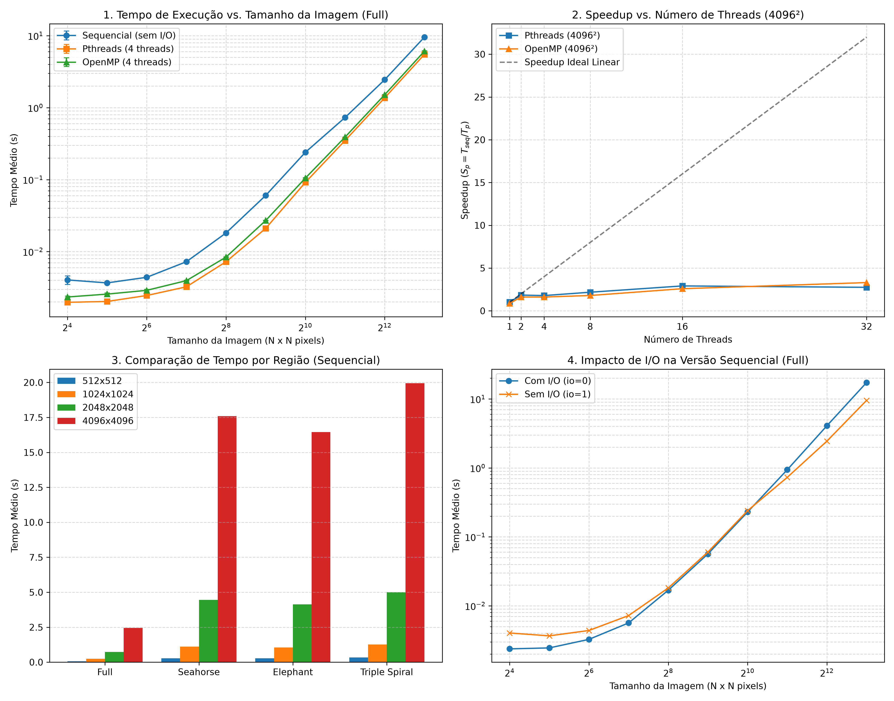
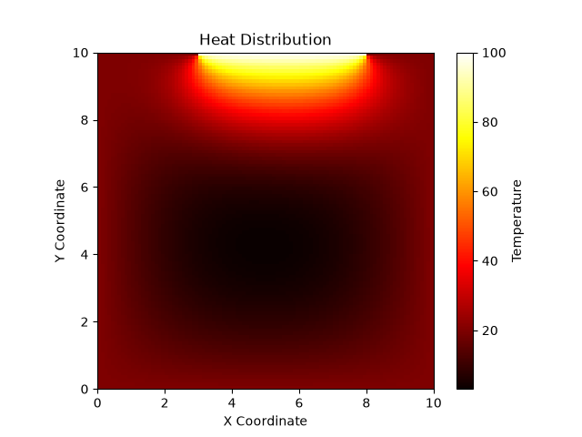

# Parallel Computing Benchmarks (OpenMP, Pthreads & CUDA)

CPU and GPU parallelization benchmarks implementing two classic compute-intensive workloads in C and CUDA:

1. **Mandelbrot Set Fractal Renderer** (`01-mandelbrot-openmp-pthreads/`): Sequential C vs. POSIX Threads (`pthreads`) and OpenMP, benchmarked across image resolutions, fractal regions, thread counts, and disk I/O modes using `perf stat`.
2. **2D Heat Equation Solver** (`02-heat-equation-cuda/`): Finite-difference Jacobi relaxation on CPU vs. NVIDIA GPU using 2D CUDA thread blocks, flattened 1D global memory buffers, and host-side pointer swapping.

---

## Repository Structure

```text
.
├── 01-mandelbrot-openmp-pthreads/
│   ├── Makefile
│   ├── mandelbrot_seq.c          # Sequential baseline (optional I/O toggle)
│   ├── mandelbrot_pth.c          # Pthreads implementation (contiguous row blocks)
│   ├── mandelbrot_omp.c          # OpenMP implementation (#pragma omp parallel for)
│   ├── run_measurements.sh       # Automated perf stat benchmark runner
│   ├── measurements.csv          # Aggregated benchmark dataset (560 configurations)
│   ├── analysis.py               # Matplotlib visualization script
│   └── mandelbrot_benchmarks.png # 4-panel scaling & I/O benchmark plot
├── 02-heat-equation-cuda/
│   ├── Makefile                  # Builds sequential CPU solver (heat.c)
│   ├── heat.c                    # Sequential 2D Jacobi solver (outputs room.txt)
│   ├── heat.cu                   # CUDA 2D Jacobi solver with CPU validation
│   ├── heat_tarefa3.cu           # CUDA solver + fixed 37 °C central heat source
│   ├── show_room.py              # Heatmap visualizer (reads room.txt -> room.png)
│   ├── comparison.py             # Automated Task 2 vs. Task 3 benchmark script
│   └── room.png                  # 100x100 steady-state temperature heatmap (1000 iters)
├── .gitignore
└── README.md
```

---

## 1. Mandelbrot Set (`01-mandelbrot-openmp-pthreads/`)

### Parallelization Design
- **Sequential (`mandelbrot_seq.c`)**: Evaluates $f_c(z) = z^2 + c$ up to `iteration_max = 200` with escape radius squared `4`, optionally writing a binary `P6` PPM image (`output.ppm`) when `no_io == 0`.
- **Pthreads (`mandelbrot_pth.c`)**: Partitions image rows into contiguous horizontal strips (`rows_per_thread = i_y_max / num_threads`, with remainder rows assigned to the last thread). Each thread writes only to its own pixel indices in `image_buffer`, requiring no mutexes during computation.
- **OpenMP (`mandelbrot_omp.c`)**: Parallelizes the outer `i_y` row loop via `#pragma omp parallel for` with loop-local iteration state declared `private`.

### Build & Run

```bash
cd 01-mandelbrot-openmp-pthreads
make

# Usage: ./mandelbrot_seq <x_min> <x_max> <y_min> <y_max> <size> [no_io: 0|1]
./mandelbrot_seq -2.5 1.5 -2.0 2.0 2048 1

# Pthreads: ./mandelbrot_pth <x_min> <x_max> <y_min> <y_max> <size> [threads] [no_io]
./mandelbrot_pth -2.5 1.5 -2.0 2.0 4096 8 1

# OpenMP: OMP_NUM_THREADS=<threads> ./mandelbrot_omp <x_min> <x_max> <y_min> <y_max> <size> [no_io]
OMP_NUM_THREADS=8 ./mandelbrot_omp -2.5 1.5 -2.0 2.0 4096 1

# Re-run full perf stat benchmark suite and regenerate plot
./run_measurements.sh
python3 analysis.py
```

### Benchmark Results (`perf stat`)

Benchmarks were collected on an **Intel Core i7-8650U** (4 physical cores / 8 logical threads, up to 4.20 GHz) running Arch Linux, compiled with GCC (`-std=c11`, `-pthread`, `-fopenmp`). Each configuration in `measurements.csv` reports the mean and standard deviation across **10 runs** (`LC_ALL=C perf stat -r 10`) over resolutions from $16 \times 16$ to $8192 \times 8192$ and thread counts $\{1, 2, 4, 8, 16, 32\}$.



Key findings from `measurements.csv`:

- **~44% I/O & Buffer Overhead (`8192 × 8192`, Full region, Sequential)**:
  - With PPM allocation and disk write (`io=0`): **$17.327 \pm 0.820\text{ s}$**
  - Compute only (`io=1`): **$9.545 \pm 0.024\text{ s}$**
  - **I/O overhead accounts for 44.92%** of total runtime at $8192 \times 8192$ (and **40.12%** at $4096 \times 4096$: $4.087\text{ s}$ vs. $2.447\text{ s}$). Disabling I/O in parallel runs (`io=1`) isolates true compute scaling.
- **Thread Scaling & Load Imbalance (`4096 × 4096`)**:
  - **Triple Spiral** (dense iteration workload across rows, sequential baseline $19.951\text{ s}$): Both implementations scale cleanly up to the 8 hardware threads—peaking at **3.77×** for Pthreads ($5.291\text{ s}$) and **3.70×** for OpenMP ($5.395\text{ s}$) at 8 threads—before slightly degrading at 16–32 threads due to oversubscription and context-switching overhead.
  - **Full Picture** (skewed workload concentrated near the center rows, sequential baseline $2.447\text{ s}$): Static contiguous row-block assignment causes load imbalance at 4–8 threads (**1.79×–2.18×** Pthreads; **1.61×–1.80×** OpenMP). Increasing to 16–32 smaller row chunks incidentally smooths the imbalance, reaching **2.91×** (Pthreads, 16 threads, $0.840\text{ s}$) and **3.31×** (OpenMP, 32 threads, $0.740\text{ s}$).
- **Fractal Region Complexity (`4096 × 4096`, Sequential, `io=1`)**:
  - **Triple Spiral** (`[-0.188, -0.012] × [0.554, 0.754]`): **$19.951\text{ s}$**
  - **Seahorse Valley** (`[-0.8, -0.7] × [0.05, 0.15]`): **$17.591\text{ s}$**
  - **Elephant Valley** (`[0.175, 0.375] × [-0.1, 0.1]`): **$16.458\text{ s}$**
  - **Full Picture** (`[-2.5, 1.5] × [-2.0, 2.0]`): **$2.447\text{ s}$**

---

## 2. 2D Heat Equation Jacobi Solver (`02-heat-equation-cuda/`)

### Problem & GPU Architecture
Models steady-state heat diffusion across a $10\text{ m} \times 10\text{ m}$ 2D room discretized on an $n \times n$ grid using Jacobi finite-difference relaxation:

$$h_{i,j}^{(k+1)} = 0.25 \left( h_{i-1,j}^{(k)} + h_{i+1,j}^{(k)} + h_{i,j-1}^{(k)} + h_{i,j+1}^{(k)} \right)$$

- **Boundary & Initial Conditions**: Outer walls fixed at $20^\circ\text{C}$, top-wall fireplace ($x \in [3\text{ m}, 7\text{ m}]$) fixed at $100^\circ\text{C}$, interior initialized to $0^\circ\text{C}$. In `heat_tarefa3.cu`, an additional constant $37^\circ\text{C}$ square body ($x, y \in [4\text{ m}, 6\text{ m}]$) is held fixed via `is_inside_body(i, j, n)`.
- **2D Grid Mapping & Pointer Swapping**:
  - The 2D matrix is linearized into 1D `double*` device buffers (`d_h`, `d_g`) indexed by `i * n + j` with 2D CUDA blocks (`dim3 threadsPerBlock(t, t)`, `dim3 numBlocks(b, b)`).
  - Before the iteration loop, the initialized host grid is copied to **both** `d_h` and `d_g` so fixed wall/fireplace boundary cells remain valid across buffer rotations.
  - Each iteration launches `jacobi_step<<<numBlocks, threadsPerBlock>>>(d_h, d_g, n)` and performs a **host-side pointer swap** (`d_h` $\leftrightarrow$ `d_g`), eliminating all per-iteration device-to-device memory copies.
- **Validation & Timing**: Every CUDA run validates the GPU output against `jacobi_cpu` using `fabs(cpu_res[i] - gpu_h[i]) < 1e-6` (`Validation: PASS`, `max diff: 0.000000e+00`). CPU timing uses `clock_gettime(CLOCK_MONOTONIC)` and GPU phases (H2D, Kernel, D2H) are measured separately with `cudaEvent_t`.



### Build & Run

```bash
cd 02-heat-equation-cuda

# Build and run sequential CPU version (writes room.txt)
make
./heat 100 1000
python3 show_room.py   # Generates room.png from room.txt

# Build and run CUDA versions (requires NVIDIA CUDA Toolkit / nvcc)
nvcc -O2 heat.cu -o heat
nvcc -O2 heat_tarefa3.cu -o heat_tarefa3

# Usage: ./heat <n> <iter_limit> <threads_per_block> <blocks_per_grid>
./heat 500 1000 16 32

# Run Task 2 vs. Task 3 comparison table
python3 comparison.py
```

### GPU Speedup Results (1000 Iterations)

#### Task 2: Standard Room (`heat.cu`, CPU vs. GPU)

| Grid ($n$) | Block ($t \times t$) | Grid ($b \times b$) | CPU Time (ms) | GPU H2D (ms) | GPU Kernel (ms) | GPU D2H (ms) | GPU Total (ms) | Speedup (Total) | Speedup (Kernel) |
| :---: | :---: | :---: | :---: | :---: | :---: | :---: | :---: | :---: | :---: |
| 100 | $8 \times 8$ | $13 \times 13$ | 55.297 | 0.074 | 3.169 | 0.037 | 3.279 | **16.86×** | 17.45× |
| 100 | $16 \times 16$ | $7 \times 7$ | 56.309 | 0.083 | 3.915 | 0.047 | 4.044 | **13.92×** | 14.38× |
| 250 | $8 \times 8$ | $32 \times 32$ | 675.327 | 0.327 | 6.116 | 0.148 | 6.591 | **102.45×** | 110.42× |
| 250 | $16 \times 16$ | $16 \times 16$ | 659.809 | 0.356 | 7.214 | 0.149 | 7.719 | **85.47×** | 91.46× |
| 500 | $8 \times 8$ | $63 \times 63$ | 2060.344 | 1.128 | 18.053 | 0.339 | 19.520 | **105.55×** | 114.13× |
| 500 | $16 \times 16$ | $32 \times 32$ | 1531.106 | 1.112 | 15.773 | 0.338 | 17.222 | **88.90×** | 97.07× |
| 500 | $32 \times 32$ | $16 \times 16$ | 1509.108 | 1.095 | 17.075 | 0.305 | 18.475 | **81.68×** | 88.38× |
| 1000 | $16 \times 16$ | $63 \times 63$ | 7431.877 | 3.905 | 100.887 | 1.744 | 106.537 | **69.76×** | 73.67× |

Across production grid sizes ($n \ge 250$), GPU execution achieves **64×–105× total end-to-end speedup** over the sequential CPU baseline (including a $500 \times 500$, $16 \times 16$ reference run at **64.40×** total / **70.22×** kernel speedup, $1521.935\text{ ms}$ CPU vs. $23.632\text{ ms}$ GPU total, up to **105.55×** total / **114.13×** kernel speedup at $n=500, t=8, b=63$).

#### Task 3: Fixed $37^\circ\text{C}$ Internal Body (`heat.cu` vs. `heat_tarefa3.cu`, `t=16`)

| Variant | Grid ($n$) | CPU Time (ms) | GPU Kernel (ms) | GPU Total (ms) | Speedup (Total) | Speedup (Kernel) | Validation |
| :--- | :---: | :---: | :---: | :---: | :---: | :---: | :---: |
| Task 2 (No body) | 250 | 372.810 | 10.870 | 11.342 | **32.87×** | 34.30× | PASS |
| Task 3 ($37^\circ\text{C}$ body) | 250 | 366.420 | 7.416 | 7.958 | **46.04×** | 49.41× | PASS |
| Task 2 (No body) | 500 | 1534.410 | 15.509 | 17.012 | **90.19×** | 98.94× | PASS |
| Task 3 ($37^\circ\text{C}$ body) | 500 | 2622.308 | 28.660 | 30.252 | **86.68×** | 91.50× | PASS |
| Task 2 (No body) | 1000 | 6150.958 | 77.809 | 83.221 | **73.91×** | 79.05× | PASS |
| Task 3 ($37^\circ\text{C}$ body) | 1000 | 7701.672 | 83.322 | 88.948 | **86.59×** | 92.43× | PASS |

Adding the internal Dirichlet boundary (`is_inside_body`) introduces minor warp divergence only along the body perimeter, while threads strictly inside skip all four global memory neighbor reads, sustaining **46×–87×** total speedup over the CPU implementation.
